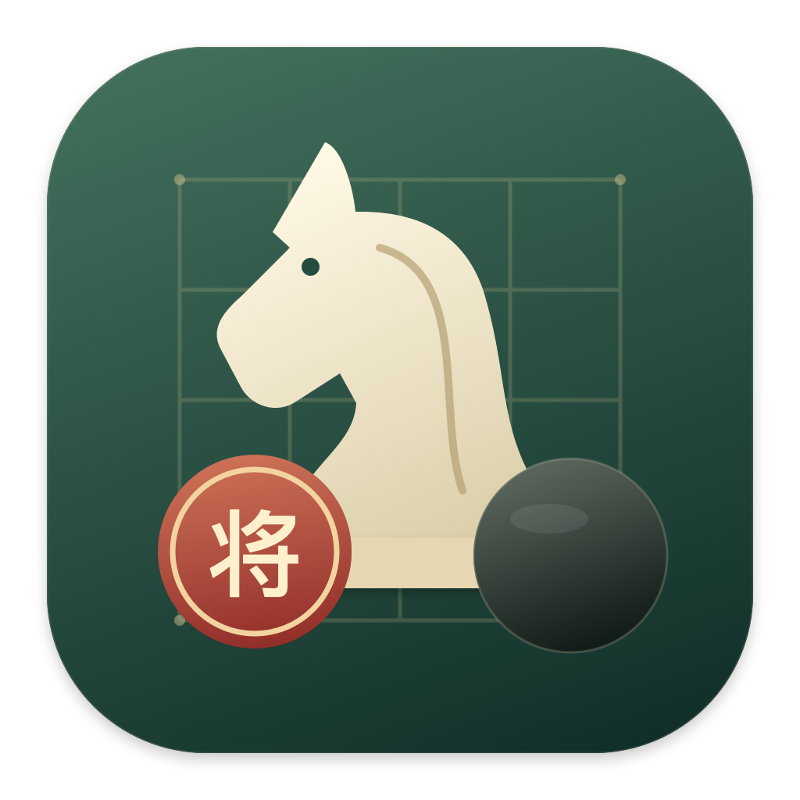

<p align="center">
  
</p>

<h1 align="center">弈间 · Yijian</h1>

<p align="center">原生 macOS 离线三棋研习室<br>国际象棋 · 中国象棋 · 围棋</p>

<p align="center">
  <a href="#安装">安装</a> ·
  <a href="docs/USER_GUIDE.md">使用指南</a> ·
  <a href="docs/BUILDING.md">源码构建</a> ·
  <a href="CHANGELOG.md">更新记录</a> ·
  <a href="LICENSE">GPL-3.0-or-later</a>
</p>

弈间是一款使用 SwiftUI 开发的中文棋类练习应用。内置 Fairy-Stockfish 与 GNU Go，在本机完成 AI 对弈和复盘分析，无需账号、联网或另行下载引擎。

## 功能

| 功能 | 内容 |
|---|---|
| 三种棋类 | 国际象棋、中国象棋、围棋；围棋可选 9／13／19 路 |
| AI 陪练 | 启蒙、入门、进阶、挑战四档，可选择先手或后手 |
| 入门教程 | 每种棋 3 课，包含规则说明、小测验与本地学习进度 |
| 对弈辅助 | 合法落点、升变选择、建议着法、悔棋、翻转棋盘与认输 |
| 棋局复盘 | 逐手回看、局面评估、建议着法与已分析局面的评估轨迹 |
| 棋谱管理 | 自动保存、搜索筛选、恢复未结束对局、完整棋谱导入导出 |
| 标准格式 | 国际象棋可导出 PGN，围棋可导出 SGF |

## 安装

1. 在本仓库的 **Releases** 页面下载 `弈间-macOS-arm64.zip`。
2. 解压后，将 `弈间.app` 拖到“应用程序”目录，再打开应用。
3. 点击“新对局”，选择棋类、难度与执子。

| 项目 | 要求 |
|---|---|
| 发布包架构 | Apple Silicon（M1 及后续芯片，arm64） |
| 系统目标 | macOS 13 及以上 |
| 已验证环境 | macOS 27.0.1、Apple Silicon |
| 网络 | 运行时不需要联网 |

当前发布包使用本机临时签名，尚未进行 Apple Developer ID 签名或公证。Intel Mac 可尝试在本机从源码构建，尚未进行实机验证。

## 快速使用

- **对弈**：国际象棋和中国象棋先选棋子，再选落点；围棋直接点击交叉点。
- **学习**：在“入门学堂”中选择棋类，完成规则阅读与小测验。
- **复盘**：打开“棋局复盘”，点击着法、拖动进度条或使用左右方向键。
- **保存**：每手棋后自动保存；在“我的棋谱”中可以继续未结束的对局。
- **备份**：导出 `.yijian` 文件，可重新导入并继续练习；PGN／SGF 目前仅支持导出。

完整操作及快捷键见[使用指南](docs/USER_GUIDE.md)。

## 棋力与规则

四档 AI 调整搜索参数，**不对应经校准的 Elo 或围棋段位**。围棋使用 GNU Go 3.8，适合入门练习；复杂死活的自动判定及形势估计可能存在偏差。

围棋采用中国数子规则、白贴 7.5 与全局同形限制。国际象棋／中国象棋的合法走法与终局由 Fairy-Stockfish 判断，练习中自动接受引擎的可申和条件。具体档位参数与规则范围见[使用指南](docs/USER_GUIDE.md#难度与规则范围)。

## 从源码构建

需要 macOS、Apple Command Line Tools、Swift 6.0 或更新版本、Python 3。实际构建验证使用 Swift 6.4。克隆或下载本仓库后，在仓库根目录运行：

```sh
bash scripts/build.sh
bash scripts/test.sh
```

构建脚本首次下载固定版本引擎源码，校验 SHA-256 后编译。产物位于 `dist/`。已有源码归档时可离线重建。详细步骤见[构建说明](docs/BUILDING.md)，当前验证结果见[验收记录](docs/verification.md)。

## 项目结构

```text
Sources/Yijian/          SwiftUI 界面与交互
Sources/YijianCore/      引擎通信、棋谱、存储、教程与围棋计分
Tests/YijianCoreTests/   规则、AI、棋谱与课程测试
Resources/              应用元数据与图标
scripts/                构建、图标绘制与引擎适配脚本
licenses/               第三方完整许可证
docs/                   使用、构建、发布与验收文档
```

## 参与贡献

欢迎通过本仓库的 Issues 报告问题，通过 Pull Request 提交改进。请先阅读[贡献指南](CONTRIBUTING.md)。

准备发布自己的构建或首次推送此项目时，请参阅[GitHub 推送与发布清单](docs/RELEASING.md)。

## 许可证与致谢

本项目源码、文档和原创图标采用 **GPL-3.0-or-later**，完整文本见 [LICENSE](LICENSE)。第三方组件保留其原有版权和许可，详见[第三方声明](THIRD_PARTY_NOTICES.md)。

- [Fairy-Stockfish](https://github.com/fairy-stockfish/Fairy-Stockfish)：国际象棋与中国象棋引擎。
- [GNU Go](https://www.gnu.org/software/gnugo/)：围棋引擎。
- 入门内容参考 [FIDE Laws of Chess](https://handbook.fide.com/chapter/e012023) 与 [British Go Association](https://www.britgo.org/intro/intro2.html)。

分发包随附引擎对应版本的源码归档、补丁、构建脚本、校验清单与许可证。
